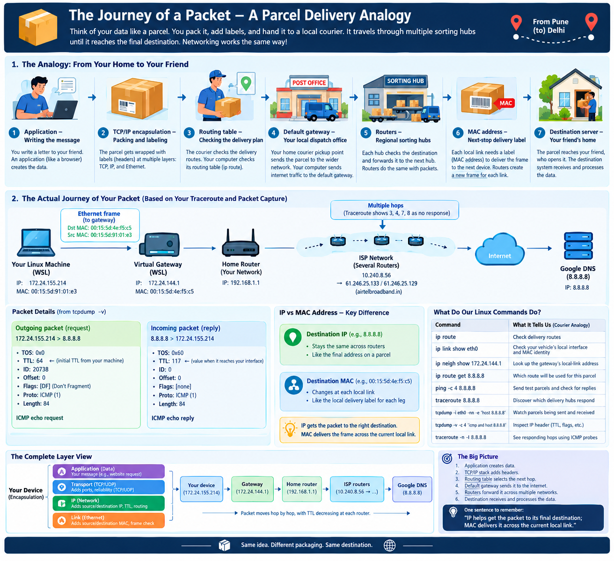

# HOW DOES THE TRAFFIC ROUTES



### 1. Routing the packet to the default gateway. After TCP/IP encapsulation, the device checks its routing table, If the destination is outside the local network, it forwards the packet to the default gateway, usually the home router. The router's MAC address is used as the destination MAC in the Ethernet frame, while the destination IP stays the final server. Key point: the routing table decides the next hop, and the default gateway provides the path outside your local network.


## 2. Checking Routing Tables and MAC Addresses

### 1. Check the Node's Routing Table

**Command:**
```bash
ip route
```

**Why do we need it?**

To check how the node routes packets and identify its default gateway.

**Example output:**
```text
default via 192.168.1.1 dev eth0
192.168.1.0/24 dev eth0 proto kernel scope link src 192.168.1.10
```

- `default via 192.168.1.1` — The default gateway's IP address.
- `dev eth0` — The network interface used to send packets.
- `192.168.1.10` — The node's IP address on this network.

### 2. Check the Node's MAC Address

**Command:**
```bash
root@DESKTOP-AFTP8GF:~# ip link show eth0
2: eth0: <BROADCAST,MULTICAST,UP,LOWER_UP> mtu 1280 qdisc mq state UP mode DEFAULT group default qlen 1000
    link/ether 00:15:5d:91:01:e3 brd ff:ff:ff:ff:ff:ff
    altname enx00155d9101e3
root@DESKTOP-AFTP8GF:~#
root@DESKTOP-AFTP8GF:~#
```

**Why do we need it?**

To identify the MAC address of the node's network interface.

**What to look for?**

```text
link/ether aa:bb:cc:dd:ee:ff
```

The value after `link/ether` is the MAC address.

### 3. Check the Default Gateway's MAC Address

**Command:**
```bash
root@DESKTOP-AFTP8GF:~# ip neigh show 172.24.144.1
172.24.144.1 dev eth0 lladdr 00:15:5d:4e:f5:c5 STALE
root@DESKTOP-AFTP8GF:~#
```

**Why do we need it?**

To view the neighbor table, which maps IP addresses on the local network to MAC addresses.

**Example output:**
```text
192.168.1.1 dev eth0 lladdr 11:22:33:44:55:66 REACHABLE
```

- `172.24.144.1` — The gateway's IP address.
- `00:15:5d:4e:f5:c5` — The gateway's MAC address.
- `REACHABLE` — The neighbor is currently considered reachable.

If the gateway does not appear, generate traffic to it and check again:

```bash
ping -c 1 192.168.1.1
ip neigh show
```

Replace `192.168.1.1` with your actual gateway IP address.

### 4. Check the Router's Routing Table

**Command (on a Linux-based router):**
```bash
ip route
```

**Why do we need it?**

To see how the router forwards packets toward their next hop and outgoing network interface.

**Important:** This command must be executed on the router itself. You need authorized access, such as SSH, if the router supports it. Most home routers provide their routing information through a web-based administration interface instead.

### Key Takeaway

- `ip route` — Displays the node's routing table.
- `ip link show` — Displays the node's network interfaces and MAC addresses.
- `ip neigh show` — Displays known neighbor IP-to-MAC mappings.
- `ip route` on the router — Displays the router's routing table, if the router supports this command.

**Packet journey:** The node checks its routing table, identifies the next hop, and sends the Ethernet frame to the next hop's MAC address. If the destination is outside the local network, that next hop is usually the default gateway.

### How packets are sent

```
root@DESKTOP-AFTP8GF:~#
root@DESKTOP-AFTP8GF:~# ip route get 8.8.8.8
8.8.8.8 via 172.24.144.1 dev eth0 src 172.24.155.214 uid 0
    cache
root@DESKTOP-AFTP8GF:~#
```

- 8.8.8.8 — The destination IP address.
- via 172.24.144.1 — The next-hop gateway.
- dev eth0 — The outgoing network interface.
- src 172.24.155.214 — The source IP address Linux selects.
- uid 0 — The user ID associated with the lookup; 0 means root.
- cache — The route lookup result is cached.


```
root@DESKTOP-AFTP8GF:~# ping -c 4 8.8.8.8
PING 8.8.8.8 (8.8.8.8) 56(84) bytes of data.
64 bytes from 8.8.8.8: icmp_seq=1 ttl=117 time=6.66 ms
64 bytes from 8.8.8.8: icmp_seq=2 ttl=117 time=18.7 ms
64 bytes from 8.8.8.8: icmp_seq=3 ttl=117 time=8.07 ms
64 bytes from 8.8.8.8: icmp_seq=4 ttl=117 time=6.98 ms

--- 8.8.8.8 ping statistics ---
4 packets transmitted, 4 received, 0% packet loss, time 3004ms
rtt min/avg/max/mdev = 6.664/10.106/18.709/4.993 ms
^C
root@DESKTOP-AFTP8GF:~#
```

### Trace the packet

```
root@DESKTOP-AFTP8GF:~#
root@DESKTOP-AFTP8GF:~# traceroute 8.8.8.8
traceroute to 8.8.8.8 (8.8.8.8), 30 hops max, 60 byte packets
 1  DESKTOP-AFTP8GF.mshome.net (172.24.144.1)  0.500 ms  0.438 ms  0.399 ms
 2  192.168.1.1 (192.168.1.1)  5.138 ms  5.062 ms  5.045 ms
 3  10.240.8.56 (10.240.8.56)  7.589 ms  7.653 ms  7.483 ms
 4  * * *
 5  dsl-del-133.25.246.61.airtelbroadband.in (61.246.25.133)  7.392 ms  7.247 ms dsl-del-129.25.246.61.airtelbroadband.in (61.246.25.129)  7.613 ms
 6  116.119.106.204 (116.119.106.204)  9.748 ms 116.119.161.131 (116.119.161.131)  9.559 ms 116.119.106.204 (116.119.106.204)  9.442 ms
 7  * * *
 8  * * *
 9  dns.google (8.8.8.8)  15.260 ms  15.870 ms  15.658 ms
root@DESKTOP-AFTP8GF:~#
```

### What happens at each hop?

- Hop 1 — 172.24.144.1: Your WSL virtual gateway receives traffic from your Linux environment and forwards it toward the external network.
- Hop 2 — 192.168.1.1: Your home network router is the likely next device.
- Hop 3 — 10.240.8.56: An address in a private IP range, likely part of your ISP's or another upstream network's internal infrastructure.
- Hop 4 — * * *: No traceroute response arrived within the timeout. The router may still have forwarded the traffic normally.
- Hops 5 and 6: The addresses and reverse-DNS name suggest traffic passing through Airtel's broadband network.
- Hops 7 and 8: Again, no responses to the probes.
- Hop 9 — 8.8.8.8: Google's DNS server responds, confirming that the destination is reachable.

```
root@DESKTOP-AFTP8GF:~#
root@DESKTOP-AFTP8GF:~# tcpdump -i eth0 -nn -e 'host 8.8.8.8'
tcpdump: verbose output suppressed, use -v[v]... for full protocol decode
listening on eth0, link-type EN10MB (Ethernet), snapshot length 262144 bytes

23:38:44.927475 00:15:5d:91:01:e3 > 00:15:5d:4e:f5:c5, ethertype IPv4 (0x0800), length 98: 172.24.155.214 > 8.8.8.8: ICMP echo request, id 36181, seq 1, length 64
23:38:44.939003 00:15:5d:4e:f5:c5 > 00:15:5d:91:01:e3, ethertype IPv4 (0x0800), length 98: 8.8.8.8 > 172.24.155.214: ICMP echo reply, id 36181, seq 1, length 64
23:38:45.929145 00:15:5d:91:01:e3 > 00:15:5d:4e:f5:c5, ethertype IPv4 (0x0800), length 98: 172.24.155.214 > 8.8.8.8: ICMP echo request, id 36181, seq 2, length 64
23:38:45.935900 00:15:5d:4e:f5:c5 > 00:15:5d:91:01:e3, ethertype IPv4 (0x0800), length 98: 8.8.8.8 > 172.24.155.214: ICMP echo reply, id 36181, seq 2, length 64
23:38:46.931051 00:15:5d:91:01:e3 > 00:15:5d:4e:f5:c5, ethertype IPv4 (0x0800), length 98: 172.24.155.214 > 8.8.8.8: ICMP echo request, id 36181, seq 3, length 64
23:38:46.945504 00:15:5d:4e:f5:c5 > 00:15:5d:91:01:e3, ethertype IPv4 (0x0800), length 98: 8.8.8.8 > 172.24.155.214: ICMP echo reply, id 36181, seq 3, length 64
23:38:47.932653 00:15:5d:91:01:e3 > 00:15:5d:4e:f5:c5, ethertype IPv4 (0x0800), length 98: 172.24.155.214 > 8.8.8.8: ICMP echo request, id 36181, seq 4, length 64
23:38:47.941524 00:15:5d:4e:f5:c5 > 00:15:5d:91:01:e3, ethertype IPv4 (0x0800), length 98: 8.8.8.8 > 172.24.155.214: ICMP echo reply, id 36181, seq 4, length 64
8 packets captured
8 packets received by filter
0 packets dropped by kernel
root@DESKTOP-AFTP8GF:~# tcpdump -i eth0 -nn -e -v -c 4 'icmp and host 8.8.8.8'
tcpdump: listening on eth0, link-type EN10MB (Ethernet), snapshot length 262144 bytes
23:40:19.736902 00:15:5d:91:01:e3 > 00:15:5d:4e:f5:c5, ethertype IPv4 (0x0800), length 98: (tos 0x0, ttl 64, id 20738, offset 0, flags [DF], proto ICMP (1), length 84)
    172.24.155.214 > 8.8.8.8: ICMP echo request, id 36182, seq 1, length 64
23:40:20.753709 00:15:5d:91:01:e3 > 00:15:5d:4e:f5:c5, ethertype IPv4 (0x0800), length 98: (tos 0x0, ttl 64, id 20882, offset 0, flags [DF], proto ICMP (1), length 84)
    172.24.155.214 > 8.8.8.8: ICMP echo request, id 36182, seq 2, length 64
23:40:20.797419 00:15:5d:4e:f5:c5 > 00:15:5d:91:01:e3, ethertype IPv4 (0x0800), length 98: (tos 0x60, ttl 117, id 0, offset 0, flags [none], proto ICMP (1), length 84)
    8.8.8.8 > 172.24.155.214: ICMP echo reply, id 36182, seq 2, length 64
23:40:21.755550 00:15:5d:91:01:e3 > 00:15:5d:4e:f5:c5, ethertype IPv4 (0x0800), length 98: (tos 0x0, ttl 64, id 20973, offset 0, flags [DF], proto ICMP (1), length 84)
    172.24.155.214 > 8.8.8.8: ICMP echo request, id 36182, seq 3, length 64
4 packets captured
5 packets received by filter
0 packets dropped by kernel
root@DESKTOP-AFTP8GF:~#
```

### From another wondow run command to capture tcp dumps

```
root@DESKTOP-AFTP8GF:~# ping -c 4 8.8.8.8
PING 8.8.8.8 (8.8.8.8) 56(84) bytes of data.
64 bytes from 8.8.8.8: icmp_seq=1 ttl=117 time=11.6 ms
64 bytes from 8.8.8.8: icmp_seq=2 ttl=117 time=6.77 ms
64 bytes from 8.8.8.8: icmp_seq=3 ttl=117 time=14.5 ms
64 bytes from 8.8.8.8: icmp_seq=4 ttl=117 time=8.89 ms

--- 8.8.8.8 ping statistics ---
4 packets transmitted, 4 received, 0% packet loss, time 3005ms
rtt min/avg/max/mdev = 6.773/10.429/14.469/2.889 ms
root@DESKTOP-AFTP8GF:~# tcpdump -i eth0 -nn -e -v -c 4 'icmp and host 8.8.8.8'
tcpdump: listening on eth0, link-type EN10MB (Ethernet), snapshot length 262144 bytes
^C
0 packets captured
0 packets received by filter
0 packets dropped by kernel
root@DESKTOP-AFTP8GF:~#
root@DESKTOP-AFTP8GF:~#
root@DESKTOP-AFTP8GF:~#
root@DESKTOP-AFTP8GF:~# ping -c 4 8.8.8.8
PING 8.8.8.8 (8.8.8.8) 56(84) bytes of data.
64 bytes from 8.8.8.8: icmp_seq=2 ttl=117 time=43.7 ms
64 bytes from 8.8.8.8: icmp_seq=3 ttl=117 time=7.66 ms
64 bytes from 8.8.8.8: icmp_seq=4 ttl=117 time=7.53 ms

--- 8.8.8.8 ping statistics ---
4 packets transmitted, 3 received, 25% packet loss, time 3020ms
rtt min/avg/max/mdev = 7.526/19.638/43.732/17.037 ms
root@DESKTOP-AFTP8GF:~#
```