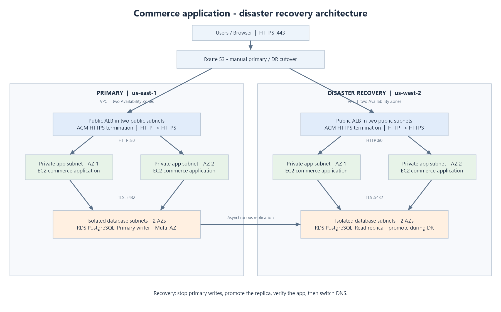
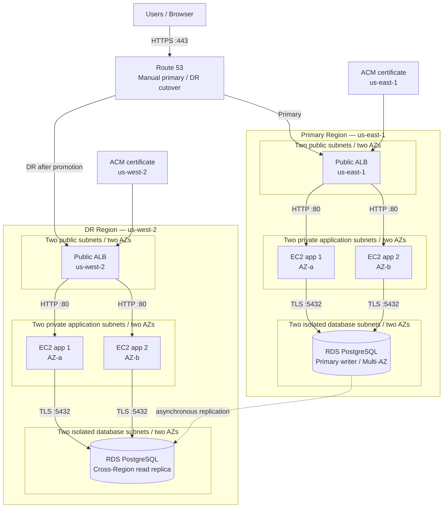

# Multi-region RDS PostgreSQL disaster-recovery project

Terraform project for the `devoops.biz` commerce application.

## Architecture



```text
shop.devoops.biz
  Route 53 alias (manual primary/DR cutover)
    ├─ us-east-1 ALB -> two manually deployed EC2 app instances -> RDS primary writer
    └─ us-west-2 ALB -> two manually deployed EC2 app instances -> RDS cross-Region replica
```



Each Region contains one VPC with two public ALB subnets, two private application subnets, and two isolated database subnets. ACM certificates terminate TLS at each regional ALB, which redirects HTTP to HTTPS. EC2 bootstrapping clones `https://github.com/Anantgs/commerse-rds-project.git` and deploys the commerce application. There is no Auto Scaling Group: failed instances require manual replacement. Route 53 is switched manually only after the replica is promoted and DR is verified.

## Deployment and DR operation

For detailed health checks and order replication verification, see [post-deployment-tests.md](post-deployment-tests.md).

The existing VPCs are retained in this Terraform state. Terraform needs a database password and a shared Flask session key. Supply them securely as environment variables rather than putting values in shell history:

```bash
read -rsp 'Database password: ' TF_VAR_db_password; export TF_VAR_db_password; echo
read -rsp 'Flask secret key: ' TF_VAR_flask_secret_key; export TF_VAR_flask_secret_key; echo
terraform init
terraform validate
terraform plan
terraform apply
```

Use a strong password of at least eight characters and a long random Flask secret. The values and connection URLs are stored in Terraform state: restrict access to state, backups, and the AWS Secrets Manager secrets. EC2 retrieves a regional secret during initial boot. To change its configuration after boot, update the secret and restart/reconfigure both instances in that region; they do not automatically poll Secrets Manager.

After apply, inspect target health in both ALBs and visit the `application_url` output. Use Systems Manager Session Manager for private instances, and check `/var/log/cloud-init-output.log`, `systemctl status commerce nginx`, and `journalctl -u commerce` if an instance is unhealthy. Place a test order, then query the primary database as described in the sibling `Application/README.md`. The DR instances read the replica and must not accept checkout traffic until promotion.

For the controlled DR lab, stop and fence both primary application instances, verify the latest test order on the replica, promote the replica in the RDS console, and wait for it to become available. Its endpoint is output as `dr_replica_endpoint`. Confirm `SELECT pg_is_in_recovery();` returns false and perform a test write on the promoted DB. Test the DR ALB and only then run `terraform apply -var='route_to_dr=true'` with the same secrets in the environment. Route 53 DNS caches can delay cutover. Promotion breaks replication; do not restart the original writers or reverse DNS until a separate failback and reconciliation plan has been executed. Promotion changes the replica outside Terraform: review state and any subsequent plan carefully before applying, because Terraform can attempt to reconfigure or replace it.

## Status

The infrastructure has been deployed. The public HTTPS endpoint and both regional target groups have been checked; follow the post-deployment tests to verify order writes and replication. The default local Terraform state contains database and Flask secrets and must be protected.

DNS cutover is manual using `route_to_dr`; promotion of the replica must happen first. The two EC2 instances in each region are standalone instances, not an Auto Scaling Group. Application startup logs are available in `/var/log/cloud-init-output.log` through Systems Manager Session Manager. The DR replica is read-only until promotion. The current bootstrap uses the RDS master login and is suitable only for an isolated lab; create a least-privilege application role before production use.

## Files

- `providers.tf` — primary and DR AWS provider aliases.
- `variables.tf` — domain, Region, application repository, and sizing inputs.
- `terraform.tfvars.example` — safe configuration template.
- `main.tf` — entry point for the regional networking, ALB, EC2, ACM, Route 53, and RDS resources.

## Planned deployment

```bash
cd 02-AWS-NOTES/RDS/rds-disaster-recovery
cp terraform.tfvars.example terraform.tfvars
terraform init
terraform validate
terraform plan
terraform apply
```

Do not commit `terraform.tfvars` or `terraform.tfstate`.
