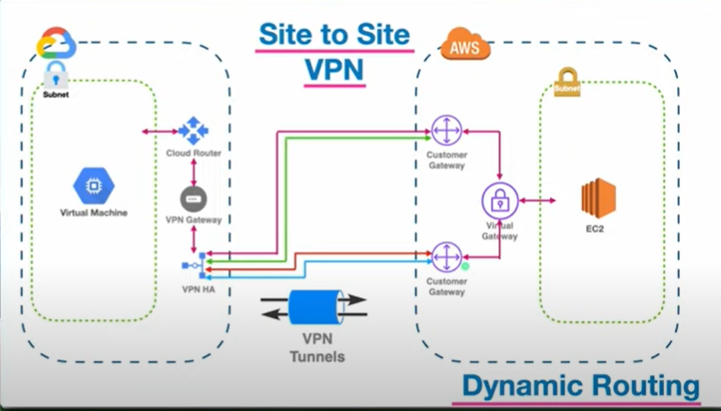
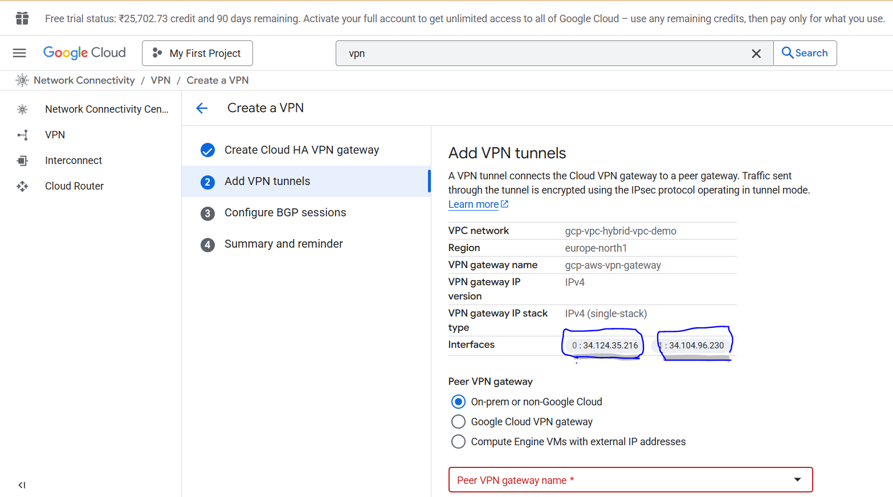
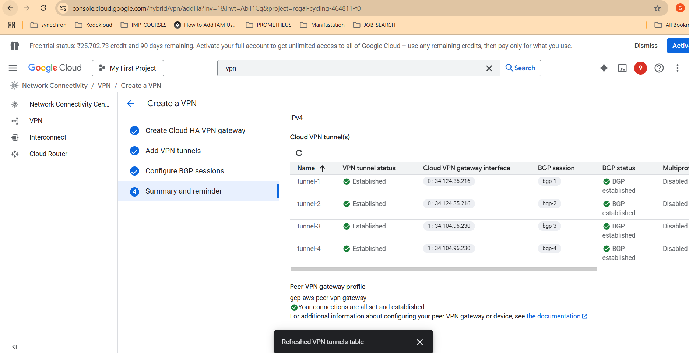
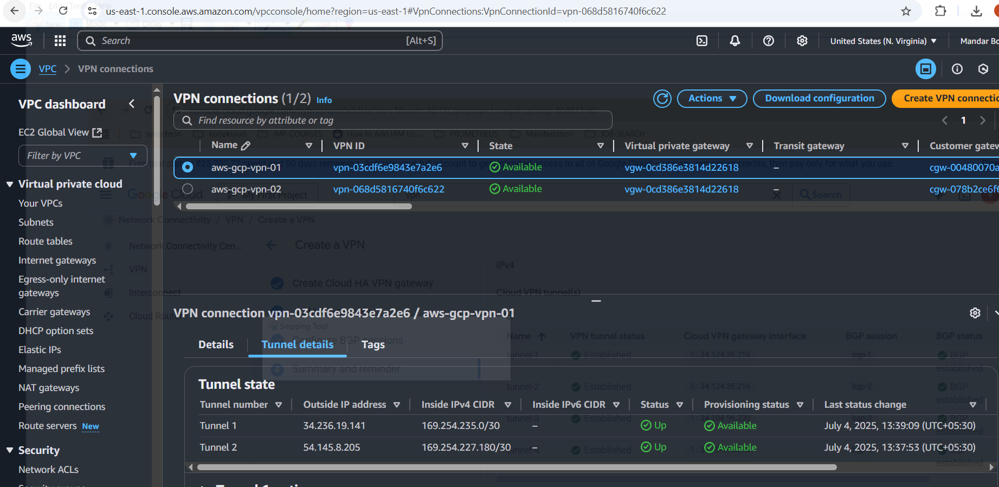

**I. Initial Infrastructure Setup (VPC & Subnets)**

1.  **Create VPC on AWS:**
    *   Navigate to **VPC** in the AWS console.
    *   Click on **Create VPC**.
    *   Select the **VPC only** option.
    *   Provide a name (e.g., `AWS VPC hybrid VPC`).
    *   Specify a **CIDR range** (e.g., `10.0.0.0/16`).
    *   Keep other options default or optional, then **create the VPC**.

2.  **Create VPC on Google Cloud:**
    *   Search for **VPC network** in the Google Cloud console.
    *   Click on **Create VPC Network**.
    *   Enter a name (e.g., `gcp VPC hybrid VPC demo connectivity`).
    *   Keep other settings default for now, as subnets will be created later.
    *   Associate necessary default routes like **ICMP** and **TCP**.
    *   Ensure **Dynamic routing mode** is set to `Regional` and **Based path selection mode** to `Legacy`.
    *   **Create the VPC**.

3.  **Create Subnets on AWS (Public and Private):**
    *   Go to the **VPC dashboard** and select **Subnets** on the left.
    *   Click on **Create subnet**.
    *   **Select the VPC** created earlier (e.g., `AWS VPC hybrid VPC`).
    *   **For the Public Subnet:**
        *   Enter a name (e.g., `AWS VPC hybrid public subnet`).
        *   Choose an **Availability Zone** (e.g., Mumbai Asia region).
        *   Assign a **CIDR range** (e.g., `10.0.1.0/24`).
    *   **For the Private Subnet:**
        *   Add another subnet.
        *   Enter a name (e.g., `AWS VPC hybrid private subnet`).
        *   Choose a different **Availability Zone** (e.g., Asia Pacific South 1B).
        *   Assign a **CIDR range** (e.g., `10.0.2.0/24`).
    *   **Create subnets**.

4.  **Create Subnets on Google Cloud (Public and Private):**
    *   Go to the created Google Cloud VPC (e.g., `gcp VPC hybrid VPC demo`) and click on its name.
    *   Select **Subnet** options.
    *   Click on **Add subnets**.
    *   **For the Public Subnet:**
        *   Enter a name (e.g., `gcp VPC hybrid public subnet`).
        *   Choose a **Region** (e.g., Europe north one).
        *   Assign an **IP range** (e.g., `21.0.1.0/24`).
        *   Confirm if it's outside RFC 1918.
        *   Click **Add**.
    *   **For the Private Subnet:**
        *   Click **Add subnet** again.
        *   Enter a name (e.g., `gcp VPC hybrid private subnet`).
        *   Choose the same **Region** (e.g., Europe north one).
        *   Assign an **IP range** (e.g., `21.0.2.0/24`).
        *   Click **Add**.

**II. Internet Gateway & Route Table Setup (AWS)**

1.  **Create Internet Gateway (AWS):**
    *   Go to the **VPC dashboard** and select **Internet Gateway**.
    *   Click on **Create internet gateway**.
    *   Provide a name (e.g., `hybrid-igw`).
    *   **Create the internet gateway**.
    *   **Attach it to the VPC**: Select the newly created Internet Gateway, click **Actions**, then **Attach to VPC**, and select your AWS VPC.

2.  **Create Route Tables (AWS):**
    *   Go to the **Route tables** section in the VPC dashboard.
    *   Click on **Create route table**.
    *   **For the Public Route Table:**
        *   Enter a name (e.g., `hybrid public RT`).
        *   Select the AWS VPC.
        *   **Create the route table**.
    *   **For the Private Route Table:**
        *   Create another route table.
        *   Enter a name (e.g., `hybrid private RT`).
        *   Select the AWS VPC.
        *   **Create the route table**.

3.  **Associate Subnets with Route Tables (AWS):**
    *   **For the Public Route Table:**
        *   Select the `hybrid public RT`.
        *   Click on **Subnet Association**, then **Edit subnet association**.
        *   Select only the **public subnet**.
        *   **Save Association**.
    *   **For the Private Route Table:**
        *   Select the `hybrid private RT`.
        *   Click on **Subnet Association**, then **Edit subnet association**.
        *   Select only the **private subnet**.
        *   **Save Association**.

4.  **Set up Internet Gateway Route (AWS Public Route Table):**
    *   Select the **public route table**.
    *   Click on **Routes**, then **Edit routes**.
    *   Click **Add route**.
    *   For **Destination**, enter `0.0.0.0/0` (for internet).
    *   For **Target**, choose the **Internet Gateway** created earlier.
    *   **Save changes**.
    *   *(Note: Google Cloud VPCs automatically come with an internet gateway route.)*

**III. Virtual Machine Instances Setup**

1.  **Spin up VM Instance on Google Cloud (Public Subnet):**
    *   Search for **VM instances** in the Google Cloud console.
    *   Click on **Create instance**.
    *   Provide a name (e.g., `gcp-public-vm`).
    *   Choose the same **Region** where your VPC and subnets are (e.g., Europe north one).
    *   Select a **Machine configuration** (e.g., smallest one for demo).
    *   In the **Networking** section (under advanced options):
        *   Select the **Network interface**.
        *   Choose your Google Cloud VPC (e.g., `gcp hybrid VPC`).
        *   Select your **public subnet**.
        *   Enable **External IP** (public IP).
    *   In the **Security** section, under **Manage access**, add your **SSH key** (public key content) to allow SSH access.
    *   **Create the instance**.

2.  **Spin up EC2 Instances on AWS (Public and Private Subnets):**
    *   Search for **EC2** in the AWS console.
    *   Click on **Launch instances**.
    *   **For the Private EC2 Instance:**
        *   Provide a name (e.g., `hybrid-ec2-private`).
        *   Choose an **AMI** (e.g., Ubuntu).
        *   Select an **Instance type** (e.g., T2 micro).
        *   Select an existing **Key pair** or import one.
        *   In **Networking**:
            *   Choose your AWS VPC.
            *   Select the **private subnet**.
            *   Set **Auto-assign Public IP** to `Disable`.
        *   In **Security Group**: Add a rule for **ICMPv4** (Ping) from `Anywhere`.
        *   **Launch instance**.
    *   **For the Public EC2 Instance:**
        *   Click on **Launch instances** again.
        *   Provide a name (e.g., `hybrid-ec2-public`).
        *   Choose the same **AMI** and **Instance type**.
        *   Select the same **Key pair**.
        *   In **Networking**:
            *   Choose your AWS VPC.
            *   Select the **public subnet**.
            *   Ensure **Auto-assign Public IP** is `Enable`.
        *   In **Security Group**: Add a rule for **SSH** and **ICMPv4** from `Anywhere`.
        *   **Launch instance**.

**IV. VPN & Gateway Configuration**

1.  **Set up Cloud Router on Google Cloud:**
    *   Search for **Cloud routers** in the Google Cloud console.
    *   Click on **Create router**.
    *   Enter a name (e.g., `gcp-AWS-router`).
    *   Select your Google Cloud VPC (e.g., `gcp VPC hybrid VPC demo`).
    *   Choose the correct **Region** (e.g., Europe North Region).
    *   Enter an **ASN** (e.g., `64512` - a unique number in a certain range).
    *   Select **Advertise all subnet visible into the cloud router**.
    *   **Create the router**.

2.  **Set up High Availability VPN on Google Cloud:**
    *   Search for **VPN** in the Google Cloud console.
    *   Click on **Create VPN**.
    *   Select **High availability VPN**.
    *   Click **Continue**.
    *   Enter a **VPN Gateway name** (e.g., `gcp-aws-vpn-gateway`).
    *   Select your Google Cloud **Network** (VPC) (`gcp-vpc-hybrid-vpc-demo`).
    *   Choose the correct **Region** (e.g., Europe north one).
    *   Keep **VPN Gateway IP version** as `IPv4` and **IPv4 single stack**.
    *   Click **Create and continue**.
    *   **Copy the two interface public IP addresses** displayed for later use on AWS.
    *   

3.  **Create Customer Gateways on AWS:**
    *   Go to **VPC** in the AWS console.
    *   Select **Customer Gateways** on the left.
    *   Click on **Create customer gateway**.
    *   **For the First Customer Gateway:**
        *   Enter a name (e.g., `hybrid-cgw-1`).
        *   Enter the **ASN** used on Google Cloud hile creating **GCP VPN** (e.g., `64512`).
        *   Paste the **first public IP address** copied from Google Cloud.
        *   **Create customer gateway**.
    *   **For the Second Customer Gateway:**
        *   Create another customer gateway.
        *   Enter a name (e.g., `hybrid-cgw-2`).
        *   Enter the same **ASN** (e.g., `64512`).
        *   Paste the **second public IP address** copied from Google Cloud.
        *   **Create customer gateway**.

4.  **Create Virtual Private Gateway on AWS:**
    *   Go to **VPC** and select **Virtual Private Gateway**.
    *   Click on **Create virtual private gateway**.
    *   Enter a name (e.g., `hybrid-vpgw`).
    *   Choose **Custome ASN** 
    *   Enter an **ASN** different from Google Cloud (e.g., `64513`).
    *   **Create virtual private gateway**.
    *   **This virtual private gateway will be used to connect to the AWS VPC**
    *   Once in `pending` state, select the VPG, click **Actions**, then **Attach to VPC**, and choose your AWS VPC.

5.  **Create Site-to-Site VPN Connections on AWS for 2 Customer Gateways:**
    *   Go to **VPC** and select **Site-to-Site VPN connections**.
    *   Click on **Create VPN connection**.
    *   **For the First VPN Connection:**
        *   Enter a name (e.g., `aws-gcp-vpn-01`).
        *   Choose **Virtual Private Gateway** as the type and select your VPG.
        *   Select the **first Customer Gateway** (e.g., `hybrid-cgw-1`).
        *   Select **Dynamic routing**.
        *   **Create VPN connection**.
    *   **For the Second VPN Connection:**
        *   Create another VPN connection.
        *   Enter a name (e.g., `aws-gcp-vpn-02`).
        *   Choose the **same Virtual Private Gateway**.
        *   Select the **second Customer Gateway** (e.g., `hybrid-cgw-2`).
        *   Select **Dynamic routing**.
        *   **Create VPN connection**.
    *   Wait for both VPN connections to be ready (they will initially be `down`).

**V. Tunnel and BGP Configuration**

1.  **Download VPN Configuration from AWS:**
    *   Select the **first VPN connection** (e.g., `hybrid-vpn-connection-01`).
    *   Click on **Download Configuration**.
    *   Choose **Generic** for Vendor, and **IKEv2** for IKE Version.
    *   **Download** and save the file (e.g., `VPN_1.txt`).
    *   Repeat for the **second VPN connection** (e.g., `hybrid-vpn-connection-02`) and save it (e.g., `VPN_2.txt`).

2.  **Set up VPN Tunnels on Google Cloud:**
    *   Go back to the Google Cloud VPN configuration where you left off.
    *   Under **VPN Gateway**, select `New VPN Gateway`.
    *   Enter the VPN Gateway name (e.g., `gcp-aws-vpn-Gateway`). *Note: This seems to be a UI step where you re-enter the name for the previously created HA VPN Gateway, not creating a new one.*
    *   Select `Four interfaces`.
    *   **Populate Outside Virtual Private Gateway IP addresses for each interface from your downloaded AWS `VPN_1.txt` and `VPN_2.txt` files**:
        *   From `VPN_1.txt`, copy the **Virtual Private Gateway IP** under **Outside IP Address** for **Tunnel 1** and **Tunnel 2**.
        *   From `VPN_2.txt`, copy the **Virtual Private Gateway IP** under **Outside IP Address** for **Tunnel 3** and **Tunnel 4**.
        *   Paste these into the respective interface fields in Google Cloud.
    *   Click **Create** (for the VPN Gateway config).
    *   Set the **Routing option** to `Dynamic`.
    *   Select your **Cloud Router**.
    *   **Configure each tunnel (Tunnel 1 to 4):**
        *   **Tunnel 1**:
            *   Enter a name (e.g., `tunnel-1`).
            *   From `VPN_1.txt`, copy the **Pre-Shared Key** for Tunnel 1 and paste it.
            *   Click **Done**.
        *   **Tunnel 2**:
            *   Enter a name (e.g., `tunnel-2`).
            *   From `VPN_1.txt`, copy the **Pre-Shared Key** for Tunnel 2 and paste it.
            *   Click **Done**.
        *   **Tunnel 3**:
            *   Enter a name (e.g., `tunnel-3`).
            *   From `VPN_2.txt`, copy the **Pre-Shared Key** for Tunnel 1 (from VPN 2 config) and paste it.
            *   Click **Done**.
        *   **Tunnel 4**:
            *   Enter a name (e.g., `tunnel-4`).
            *   From `VPN_2.txt`, copy the **Pre-Shared Key** for Tunnel 2 (from VPN 2 config) and paste it.
            *   Click **Done**.
    *   Click **Create and continue**.

3.  **Set up BGP Sessions on Google Cloud:**
    *   For each tunnel (Tunnel 1 to 4), click **Configure BGP Session**.
    *   **For BGP Session 1 (for Tunnel 1):**
        *   Enter a name (e.g., `bgp-1`).
        *   Enter the **Peer ASN** (AWS's VPG ASN, e.g., `64513`).
        *   Set **Allocate BGP IPv4 address** to `Manual`.
        *   From `VPN_1.txt` (Tunnel 1), copy the **Inside IP Addresses** ---> **Customer Gateway** (Google Cloud's end and AWS's end) and paste them into the respective fields.
        *   **only copy ipaddress not net mask (169.254.235.2 not 169.254.235.2/30)** 
        
        **eg : Inside IP Addresses**
             **- Customer Gateway         		: 169.254.235.2/30**
             **- Virtual Private Gateway             : 169.254.235.1/30**

        *   Click **Save and continue**.
    *   **For BGP Session 2 (for Tunnel 2):**
        *   Enter a name (e.g., `bgp-2`).
        *   Enter the **Peer ASN** (e.g., `64513`).
        *   Set **Allocate BGP IPv4 address** to `Manual`.
        *   From `VPN_1.txt` (Tunnel 2), copy the **Inside IP Addresses** ---> **Customer Gateway** and paste them.
        *   Click **Save and continue**.
    *   **For BGP Session 3 (for Tunnel 3):**
        *   Enter a name (e.g., `bgp-3`).
        *   Enter the **Peer ASN** (e.g., `64513`).
        *   Set **Allocate BGP IPv4 address** to `Manual`.
        *   From `VPN_2.txt` (Tunnel 1 from VPN 2 config), copy the **Inside IP Addresses** ---> **Customer Gateway** and paste them.
        *   Click **Save and continue**.
    *   **For BGP Session 4 (for Tunnel 4):**
        *   Enter a name (e.g., `bgp-4`).
        *   Enter the **Peer ASN** (e.g., `64513`).
        *   Set **Allocate BGP IPv4 address** to `Manual`.
        *   From `VPN_2.txt` (Tunnel 2 from VPN 2 config), copy the **Inside IP Addresses** ---> **Customer Gateway** and paste them.
        *   Click **Save and continue**.
    *   Click **Save BGP sessions**.
    *   Wait for all four tunnels to show **Established** status on Google Cloud and **Up** status on AWS.

    

    

**VI. Route Propagation & Testing Connectivity**

1.  **Enable Route Propagation on AWS Route Tables:**
    *   Go to **VPC** -> **Route tables** in AWS.
    *   Select the **public route table**.
    *   Click on **Route Propagation**, then **Edit route propagation**.
    *   **Enable** route propagation.
    *   **Save**.
    *   Repeat for the **private route table**.

2.  **Test Connectivity:**
    *   **SSH into the Google Cloud public VM instance**.
    *   From the Google Cloud VM, **ping the Private IP address of the AWS EC2 instance** running in the private subnet.
    *   A successful ping indicates that the hybrid connectivity is established and traffic is flowing privately between the Google Cloud and AWS networks, effectively behaving like a Local Area Network (LAN).

This setup provides high availability with 99.99% availability due to the four VPN tunnels running between AWS and Google Cloud, ensuring continued service even if one tunnel goes down.
